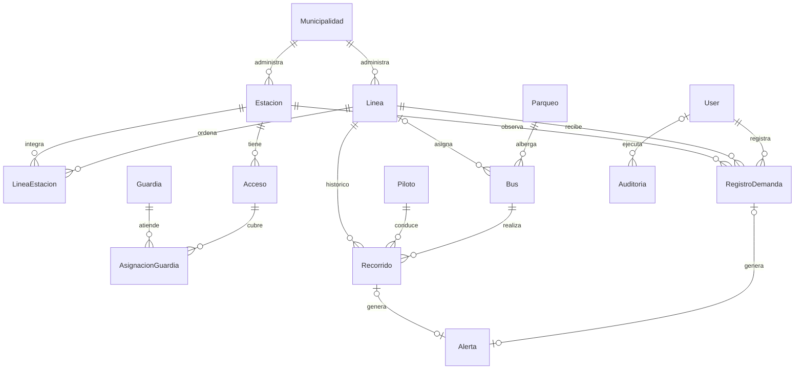

# Modelo de datos

| Modelo | Campos y relaciones principales |
| --- | --- |
| Municipalidad | nombre único, activo |
| Linea | nombre único, municipalidad PROTECT, activo, estaciones N:M |
| Estacion | nombre único, municipalidad PROTECT, dirección, activo |
| LineaEstacion | línea, estación, orden ≥ 1, distancia_desde_anterior ≥ 0 |
| Acceso | nombre único, estación PROTECT, activo |
| Parqueo | nombre único, dirección, activo |
| Bus | código único, capacidad > 0, estado, línea opcional PROTECT, parqueo obligatorio PROTECT |
| Piloto | nombres, apellidos, identificación interna única, teléfono, correo, dirección, residencia, nivel e historial educativo, activo |
| Operador | nombres, apellidos, identificación interna única, teléfono, correo, activo |
| Guardia | mismos campos administrativos que Operador |
| AsignacionGuardia | acceso, guardia (ambos PROTECT), activo; par único |
| Recorrido | bus, línea, piloto PROTECT; fecha, horas, ocupación estimada %, estado, observaciones, capacidad de referencia histórica |
| RegistroDemanda | estación, línea, usuario responsable PROTECT; fecha, hora, cantidad ≥ 0, observaciones, capacidad histórica |
| Alerta | tipo, fecha/hora, línea, estación/bus opcionales, demanda/recorrido opcionales únicos, descripción, nivel, estado |
| Auditoria | usuario SET_NULL, fecha/hora, módulo, acción, registro afectado, descripción |
| User/Group/Permission | Modelos estándar de Django |

No hay modelos auxiliares persistentes fuera del mínimo. `Catalogo`, `Persona` y
`ValidatedModel` son clases abstractas para reutilización de campos y validación;
no crean tablas. La relación opcional Alerta → Recorrido permite no duplicar una
alerta de baja ocupación y ubicar su evidencia original. Las capacidades de
referencia almacenadas evitan recalcular umbrales históricos si cambia un bus.

Distancia total = SUM de distancias de tramos de la línea, calculada por ORM.
Los pares (línea, orden), (línea, estación) y (acceso, guardia) son únicos en SQLite.
CHECK asegura capacidad positiva, orden positivo, distancia no negativa, demanda
no negativa, porcentaje 0–100 y hora final no anterior al inicio. Las reglas que
cruzan varias tablas se ejecutan en `clean()` y en los servicios, no mediante SQL.

Los campos `activo=False` definen preparación o baja; no eliminan historial.
Un recorrido conserva su línea aunque después el bus sea reasignado. Las horas
pertenecen al mismo día: un recorrido nocturno que atraviese medianoche se registra
en segmentos diarios. SQLite reside en `db.sqlite3`, ignorado por Git.
